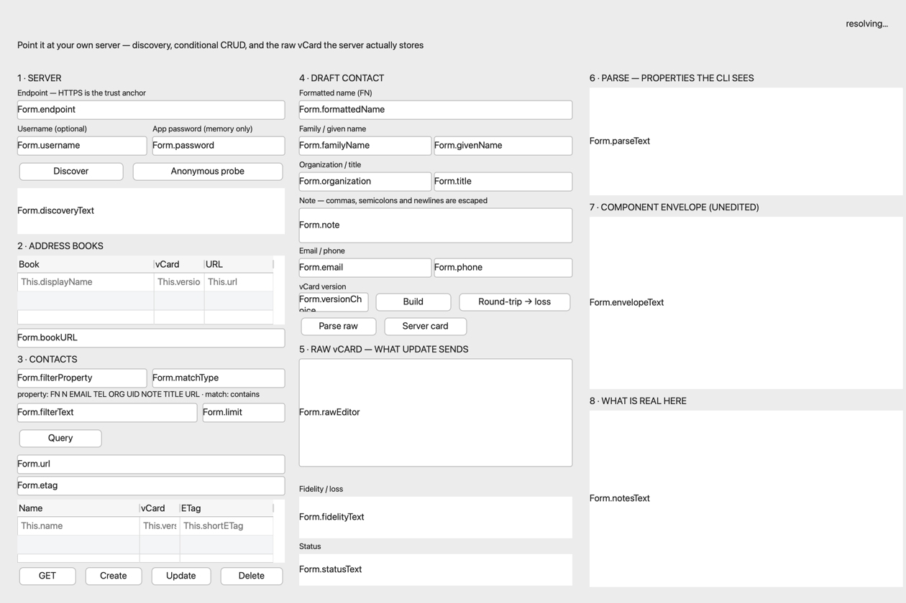
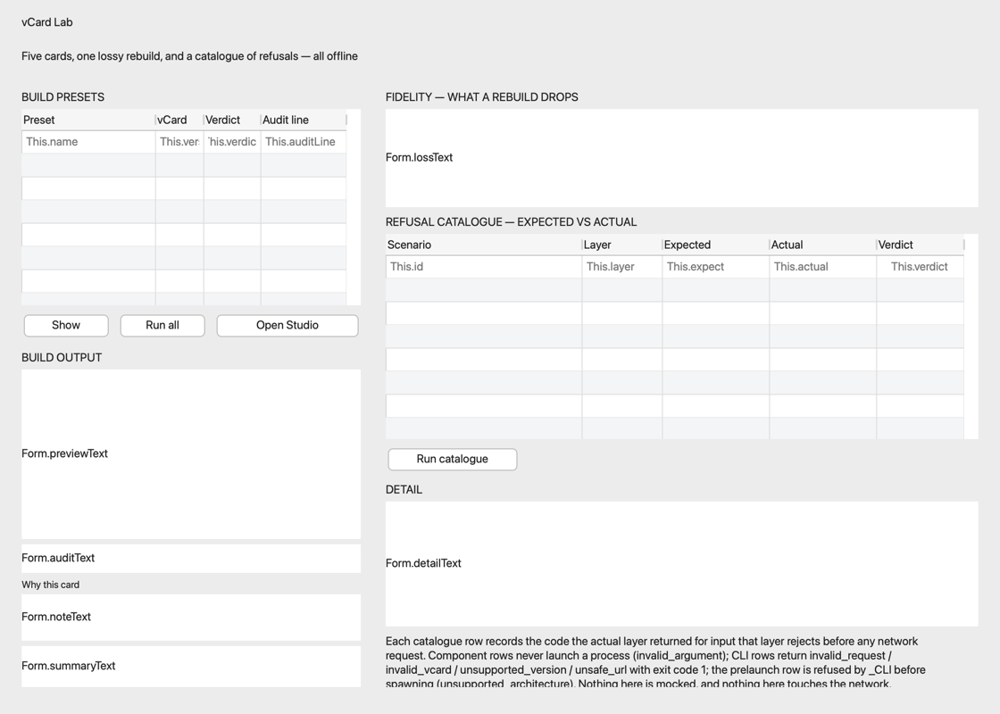

# CardDAV-demo

A 4D project that consumes [miyako/CardDAV](https://github.com/miyako/CardDAV)
(`cs.CardDAV.Client`, component `0.1.2`) and shows what its contract actually
guarantees: a raw vCard `Text` that survives `parse()`, conditional CRUD driven
by ETags, and a closed builder that refuses everything it cannot represent.

Two windows, both aimed at things you can try in a minute:





## What to try

**CardDAV Studio** — the live workbench. Point it at your own CardDAV server
(iCloud, Fastmail, Radicale behind a real certificate) and press *Discover*:
the discovery chain, the address books, a filtered query and the raw vCard the
server stores are all shown as returned, envelope and all. Create, update and
delete carry the ETag that is on screen, so pressing *Update* twice shows the
second call refused as `conflict` instead of silently overwriting.

No server at hand? *Anonymous probe* runs one `discover` against a public
endpoint with no credentials and shows the refusal the server really returns —
network evidence without a secret.

**vCard Lab** — the offline showcase. Five presets (minimal 3.0, Japanese 4.0,
escapes, folding, a server-shaped card) are built by the real CLI and audited
byte by byte. *Round-trip → loss* is the centre of the demo: the card parses
losslessly into ten properties, a rebuilt card keeps two, and every dropped
property is named.

## The one lesson

`parse()` is lossless and `build()` is not.

```4d
$parsed:=This.client.parse($raw)          // raw Text back, byte for byte
$sent  :=$raw                             // update() must send this
$lost  :=$this.client.build($parsed.value) // uid + FN only: PHOTO, groups, X-* gone
```

Send the raw Text to `update()`. Rebuilding a card from the parsed summary
silently drops `PHOTO`, grouped properties (`GROUP.EMAIL`) and every `X-*`
property — the Lab window names each one.

## Failure atlas

Lab ships fifteen refusals captured from the real component and CLI: a build
without `FN`, vCard 2.1, an unknown contact field, a NUL inside `UID`, empty or
UID-less or double vCards, a weak or unquoted ETag, an `http://` endpoint,
private-address discovery, a `Null` request, an unknown operation and a wrong
native target. Each row shows the layer that refuses it and the code it returns;
none of them needs a network.

## Run it

Open `Project/CardDAV-demo.4DProject` in 4D 21.2 (LTS) or later. The menu
**Demo → CardDAV Studio / vCard Lab** opens each window.

The component is declared in `Project/Sources/dependencies.json` and installs
through 4D's Dependency manager:

```json
{"version": 2100, "dependencies": {"CardDAV": {"github": "miyako/CardDAV", "tag": "0.1.2"}}}
```

## Headless acceptance

`tool4d` has no Dependency manager, so the component is staged first, then one
interpreted run drives both windows' classes and every offline lesson:

```sh
scripts/smoke.sh                # stages CardDAV 0.1.2, runs Demo_HeadlessSmoke
scripts/smoke.sh /tmp/report.json
```

The smoke method only performs calls that need no socket: `version()`, `parse()`,
`build()`, the round-trip loss report and the whole atlas. It also loads both
forms and checks that every object the form methods dispatch on exists.

Current result on macOS 27.2.1 arm64, 4D 21.2 LTS build 21.100694, interpreted:

```
55 of 55 checks passed
```

Report at `/tmp/CardDAV-demo-smoke.json`; `scripts/verify.py` asserts it.

| Check | Status |
| --- | --- |
| Interpreted headless run, offline lessons (55 assertions) | `passed` |
| `.4DForm` load + every dispatched object present | `passed` |
| 4D compilation of this project | `not_run` |
| Live discovery / query / CRUD against a real CardDAV server | `not_run` — needs credentials |
| Anonymous probe (network) | `not_run` in CI; interactive only |
| macOS Intel, Windows | `not_run` |
| Signing / notarization | `not_run` — unsigned demo |

## Layout

| Path | Contents |
| --- | --- |
| `Project/Sources/Classes/Studio.4dm` | Live workbench: discovery, books, query, CRUD, anonymous probe |
| `Project/Sources/Classes/Lab.4dm` | Presets, fidelity report, refusal atlas |
| `Project/Sources/Classes/CardText.4dm` | Octet/CRLF/folding audit and property-diff helpers |
| `Project/Sources/Forms/{Studio,Lab}` | Forms + one dispatch method each |
| `Project/Sources/Methods/Demo_HeadlessSmoke.4dm` | Headless acceptance, writes the JSON report |
| `scripts/make_forms.py` | Generates both `.4DForm` files from one layout |
| `scripts/fetch_dependency.py` | Pins and stages the component release (SHA256 checked) |
| `docs/FINDINGS.md` | Chokepoints, failures and findings from building this demo |

Credentials are never stored: the password field lives in memory for the
session, is not written to disk and never appears on a command line.

## Provenance

* Component: `miyako/CardDAV` tag `0.1.2`, `CardDAV.zip`
  `sha256:f8d6c5a949bd48306aa6ceb89423c735b565301a9eff9dd5743dce08ef038cc9`
* Project: `compatibilityVersion` 2102, `tokenizedText: false`
